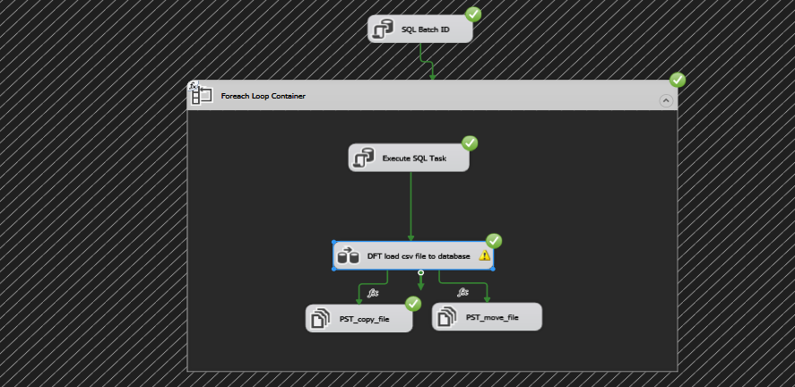
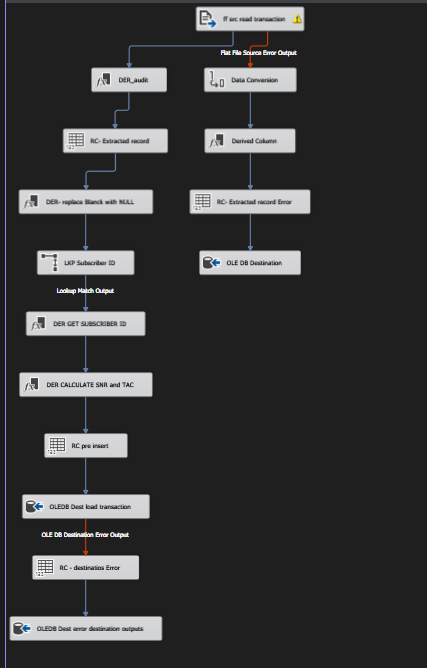

# 📡 Telecom ETL: Data Transformation with SSIS

An SSIS ETL pipeline that automatically loads telecom transaction CSV files into SQL Server. It cleans the data, enriches it with a subscriber lookup, calculates **SNR** and **TAC**, tracks every load in an audit table, and redirects bad rows to dedicated error tables instead of failing the whole run.

  

---

## 📌 Overview

| | |
|---|---|
| **Source** | Telecom transaction CSV files (IMSI, IMEI, signal data, ...) |
| **Destination** | SQL Server (fact table, audit table, error tables) |
| **Tool** | SQL Server Integration Services (SSIS) |
| **Package** | `load data.dtsx` |

---

## 🧭 Control Flow



| Step | Task | Purpose |
|---|---|---|
| 1 | **SQL Batch ID** | Gets the next `batch_id` from the audit table for the current run |
| 2 | **Foreach Loop Container** | Loops over every CSV file in the source folder |
| 3 | **Execute SQL Task** | Inserts an audit row (batch id, package name, file name) and returns the new `audit_id` |
| 4 | **DFT load csv file to database** | The main data flow that loads the file |
| 5 | **PST_copy_file** / **PST_move_file** | Copies and moves the processed file out of the source folder |

---

## 🔄 Data Flow



### Main path (valid rows)

1. **`ff src read transaction`**: Flat File Source reading the CSV
2. **`DER_audit`**: adds audit columns (batch id, audit id) to every row
3. **`RC- Extracted record`**: Row Count of extracted rows
4. **`DER- replace Blank with NULL`**: converts empty strings to `NULL`
5. **`LKP Subscriber ID`**: Lookup that matches the row to its subscriber
6. **`DER GET SUBSCRIBER ID`**: Derived Column that maps the subscriber ID
7. **`DER CALCULATE SNR and TAC`**: computes **SNR** and **TAC** values
8. **`RC pre insert`**: Row Count before loading
9. **`OLEDB Dest load transaction`**: loads rows into the SQL Server fact table

### Error handling

| Error source | Flow | Result |
|---|---|---|
| **Flat File Source error output** | Data Conversion → Derived Column → `RC- Extracted record Error` → OLE DB Destination | Unreadable rows are saved to an error table |
| **OLE DB Destination error output** | `RC - destination Error` → `OLEDB Dest error destination outputs` | Rows rejected at insert time are saved with their error code and column |

Row Count transformations feed the audit table, so each file has a record of how many rows were **extracted**, **inserted**, and **rejected**.

---

## 🛠️ Tech Stack

- **SQL Server Integration Services (SSIS)**
- **SQL Server** and **SSMS**
- **Visual Studio** (SQL Server Data Tools)
- **T-SQL**

---

## 🧩 Challenges Solved

- **Code page conflict (1252 vs 1256):** the Flat File error output column used code page 1252 while the destination column used 1256. Fixed with a Data Conversion on the error output.
- **Truncation errors on IMSI / IMEI:** column lengths in the flat file, Derived Column, and table were out of sync (IMSI is 15 digits, IMEI is 15 to 16). Aligned the lengths everywhere.
- **Blank values:** handled with a Derived Column expression that converts empty strings to `NULL`.
- **Expression syntax:** debugged a Derived Column expression that failed because of an Arabic question mark (`؟`) typed instead of `?`.
- **Audit insert:** fixed an `Execute SQL Task` failure caused by malformed comments (`- -` instead of `--`) inside the query.
- **Error rows:** redirected bad rows to error tables so one bad record never stops the whole file.

---

## 🚀 How to Run

1. Create the database and tables (fact, audit, error tables).
2. Open `Integration Services Project2.slnx` in Visual Studio.
3. Update the connection managers:
   - **Flat File Connection Manager**: point it to your source CSV folder.
   - **OLE DB Connection Manager**: point it to your SQL Server instance and database.
4. Set the Foreach Loop folder and file pattern (`*.csv`).
5. Run `load data.dtsx`.

> **Note:** the CSV files are not included in this repo because real telecom data contains IMSI and IMEI values. Use your own sample data with the same columns.

---

## 📁 Repository Structure

```
.
├── Integration Services Project2.slnx
├── Integration Services Project2.dtproj
├── Project.params
├── load data.dtsx          # main package
├── load data 1.dtsx
├── docs/
│   ├── control-flow.png
│   └── data-flow.png
├── .gitignore
└── README.md
```

---

## 👤 Author

**Mazen Sabry**
Junior Data Engineer

- GitHub: [@eng-mazensabry](https://github.com/eng-mazensabry)
